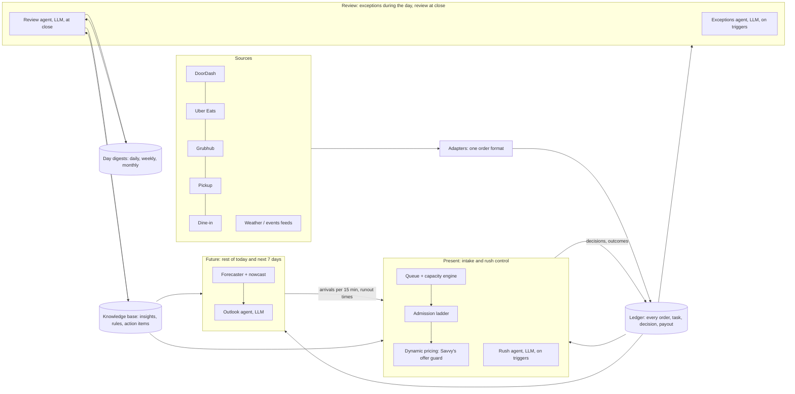

# Gondola: Present / Future / Review architecture

Branch `varun/tri-workflow`, created from `savvy/rush-control`. Status: proposed design for review. Nothing in this document is built yet.

Savvy's Rush Control (shared kitchen reservations, demand steering through approved offers, the Gemini intervention agent and the strategy lab) is kept intact and becomes the core of **Present**. Existing work (forecasting, Books, the close pipeline, reports, Ask, alerts) is regrouped, not deleted.

## 1. The shape

One shared **Ledger** records everything that happens. Three agentic workflows read it and act. A **Knowledge base** carries what was learned from one day to the next.



| Part | Runs | Agentic? | What it owns |
|---|---|---|---|
| **Ledger** (shown as "Past") | Continuously | No: deterministic code | The record of the day: orders, tasks and their real durations, decisions, cancellations, payouts, cash. Running KPIs. Learned prep times. |
| **Present** | Every minute, plus on every new order | Controller is code; **Rush agent** is LLM | Which orders to accept, when, in what order, and what to promote or pause. |
| **Future** | Every 15 min, plus at close | Forecaster is code; **Outlook agent** is LLM | Expected orders for the rest of today and the next 7 days, events and why, runout times for limited items, the prep card. |
| **Review** | On exception triggers during the day, and at close | **Exceptions agent** and **Review agent** are LLM | What went well and wrong, root causes, action items, alerts, and what gets remembered. |

Rule carried over from V2: numbers come from code, never from a model. Agents choose actions and explain them; every number they write is checked against tool outputs.

## 2. Ledger (Past)

An append-only event log in the existing local store, typed and timestamped. It is the single source every workflow reads.

| Event | From | Used by |
|---|---|---|
| `order.received / accepted / quoted / deferred / declined` | Adapters, Present | Everyone |
| `task.started / finished` (station, real duration) | Kitchen display / simulation | Present (learning), Review |
| `courier.eta_updated / arrived`, `customer.arrived` | Platform webhooks / simulation | Present |
| `order.handed_off / cancelled (reason) / refunded` | Platforms, POS | Review, Books |
| `action.applied` (throttle, pause, offer, price change) with its reason | Present, Review | Review, the knowledge base |
| `forecast.issued` (horizon, P10/P50/P90) | Future | Review (scoring), Present |
| `payout.report_arrived`, `cash.counted` | Books connectors | Books, Review |
| `exception.raised / resolved` | Exceptions agent | Review |

**Deterministic processors on the ledger** (no LLM):
- Running KPIs for the "Past" screen: orders processed, sales by channel, promises met, average and worst wait, cancellations.
- **Prep-time learning:** an exponential moving average per item and station from observed `task.finished`, as Savvy's engine already does. It feeds Present's capacity model.
- **Books:** cash drawer at close, payout estimates tonight, verification when each app's report lands (DoorDash the next evening, Uber up to 72 h), dispute checklist. This is the existing V2 code.
- **Forecast scoring:** every `forecast.issued` is scored against actuals, which feeds the forecast's error ranges.

## 3. Present: intake and rush control

The problem: 12 DoorDash, 8 Uber Eats, 5 dine-in and 4 pickup orders arrive within 15 minutes. The kitchen could make all 29, but not at once. Present decides how much work to take, when, and in what order.

### 3.1 Capacity model (Savvy's engine, extended)

Savvy's `Kitchen` reservation scheduler stays the engine. It models stations, shared cooks, packing, task dependencies, work in progress that can't move, and learned durations. Three extensions:
1. **Forecast arrivals:** reserve expected capacity for the next 30–60 minutes from Future's per-channel arrival forecast, so an order isn't accepted that would starve the guaranteed dine-in rush 20 minutes later.
2. **Learned durations by daypart:** the duration average is per item and station; it can be split by load level if the data supports it.
3. **Uncertainty buffer:** padding grows with forecast width, weather (courier ETAs get noisier in rain and snow) and incident state (for example the fryer at half speed).

### 3.2 Order queue: what to cook next

Every order from every platform lands in one queue. For each order the engine computes:

- **Due time** = the earliest of the customer promise, the courier's ETA (delivery) and "customer already here" (dine-in or pickup in the store).
- **Latest start** = due time − remaining cook time − packing, using learned durations and current station speed.
- **Slack** = latest start − now.

The queue is ordered by slack, with these adjustments, each a named, tunable parameter:

| Factor | Effect | Source |
|---|---|---|
| Courier distance / ETA | Far courier → later due time, more slack; arriving now → no slack | Dasher status / Uber estimated pickup (partner access); simulated in the demo |
| Customer travel distance | Long drive-time orders finish closer to pickup to limit holding | Delivery address distance band (platforms usually give an ETA, not GPS) |
| Hold tolerance | Fried items start as late as possible; held items (rice bowls) can start early | Menu configuration |
| Weather | Rain or snow adds an ETA-uncertainty buffer; cold weather tightens hold tolerance | Weather feed (Future) |
| Station batching | Same-station items due within a few minutes are grouped | Engine |
| Fairness cap | No order waits past a maximum age, so slow channels can't starve | Configuration (Savvy uses 35 min) |
| Channel | **No priority by channel by default.** Only physically present guests get a bump | Rule |

Frozen rules from Savvy's engine stay: work in progress never moves, promises are never silently moved, and re-shuffling is limited (the churn count). Infeasible commitments are shown, not hidden.

### 3.3 Admission ladder: how much to accept, and when

**Headroom** = capacity over the next 30 minutes − reserved work − forecast arrivals. The controller moves along the ladder below with hysteresis (it must stay past a step for 2+ minutes before moving), so it doesn't flap.

| Headroom | Action | Channel scope |
|---|---|---|
| Above +20% | **Promote** (Savvy's pricing): feature items that use idle stations, within budget and margin floors | Own channels; DoorDash/Uber campaigns where access exists |
| 0 to +20% | Normal | All |
| −10% to 0 | **Quote longer prep times** by the predicted delay | Delivery apps |
| −25% to −10% | **Pause slow items** on delivery (the V2 Guard logic, per limited item and per station) | Delivery apps, Grubhub first because its pause is slowest |
| Below −25% | **Busy mode** per app, cheapest-contribution app first; stop all promotions | Delivery apps only. **Never dine-in** |

Every step is an `action.applied` event with its reason and the headroom numbers behind it. In the demo all actions are simulated; real writes need partner access (DoorDash item status and store pause, Uber suspension, Deliverect busy mode), as found in the earlier feasibility check.

### 3.4 Dynamic pricing (Savvy's, unchanged)

Kept exactly as built: approved items and discounts only, and checks for stock, budget, contribution floor, lead-time reserve and existing predicted lateness against the same reservations as the queue. "Connected control" means pricing reads the same headroom as the admission ladder: it promotes only when there's real room on the station that makes the item. The strategy lab stays as the only way a new pricing or queue policy goes live (independent evaluation before activation).

### 3.5 Rush agent (LLM)

The controller handles routine decisions every minute without a model. The Rush agent (Savvy's intervention agent, generalized) is called only on **triggers**:
- headroom predicted below −10% within 20 minutes;
- an incident (station slowdown, a cook missing);
- a cluster of courier delays;
- a guard conflict (pricing wants to promote what the ladder wants to pause).

Tools: `get_state`, `get_queue`, `simulate(action)` (runs the engine forward with a candidate action), `apply(action)` (guarded and bounded), `explain`. It may only choose from the ladder's actions and the approved offers; the guard has the final word. Every call leaves a receipt, as in Rush Control today.

## 4. Future: the rest of today and the next 7 days

**Forecaster (code), every 15 minutes:**
- **Nowcast:** adjusts the rest of today from the gap between the forecast and actual orders so far (a ratio with shrinkage, so one slow half-hour doesn't swing the evening).
- **Per channel and per 15 minutes,** which is what Present needs for capacity reservations.
- **Event and weather drivers** with effects measured from history (same weekday with vs without the event; marked "estimate" when there are fewer than 3 examples). This is the "Expected tonight" card.
- **Limited items:** projected runout time per item at current prep, and the prep card at close (newsvendor, per item: chashu, ajitama eggs, gyoza, tonkotsu broth).
- **Horizon up to 7 days,** with ranges widening further out and climatology weather past tomorrow.

**Outlook agent (LLM):**
- Reads new events (sports schedules, weather alerts, local events) and the knowledge base's event effects, and decides whether the base forecast needs a **bounded adjustment** (±15% max per driver; each adjustment cites evidence and is logged).
- Writes the short "why" for each driver.
- Flags anything the forecast can't know ("Concert at PPG Paints Arena, no past examples").

## 5. Review: during the day and at close

**Exceptions agent (the "Option 1" role), during the day, on ledger triggers:**
- order past due by more than 10 minutes, a refund or cancellation cluster, an error charge, a payout mismatch when a report lands, a station incident lasting more than 15 minutes, a forecast miss beyond its range by mid-service.
- It investigates with ledger tools and decides: **alert now** (Sentinel text, bundled, with quiet hours), **hand to Present** (for example "pause gyoza on Grubhub"), or **note for the close review**. It writes a short exception note into the ledger.

**At close (Close shift):**
1. Deterministic closers: Books (cash; payout estimates; verify reports that have arrived), limited-item leftovers confirmed by the manager, forecast scoring.
2. **Review agent** reads the day's digest inputs (section 6) and writes:
   - **What went well / what went wrong,** each tied to numbers and times: promises met, worst waits, ladder actions and whether they helped, pricing outcomes, forecast accuracy, sell-outs.
   - **Root causes** (for example "fryer slowdown 17:42–18:10 caused 6 of 8 late orders").
   - **Action items** for the following days, each with an owner, a check date and the measure that will show it worked.
   - **Knowledge updates** proposed (section 6.3).
3. Report (2-page PDF), bundled text and email, as in V2.
4. **Tomorrow's prep card** from Future, for the manager to approve.

## 6. Feedback loop and context management

The goal is for the agents to get better every day without their context filling up with old reports. The answer is three tiers of memory, each with a size budget, and code (not the model) deciding what enters a prompt.

### 6.1 Three memory tiers

| Tier | What it holds | Written by | Size | Lifetime |
|---|---|---|---|---|
| **Working context** | The current state snapshot for one agent call: a few numbers, the queue head, open exceptions, top relevant knowledge items | Code, fresh per call | ≤ 3k tokens | One call |
| **Episodic: digests** | Structured summaries: a **shift log** every 60 minutes (≤ 5 bullets each), a **day digest** at close (≤ 1 page JSON), **weekly** digests from 7 days, **monthly** from the weeklies | Exceptions/Review agents, with code-computed numbers | Fixed caps per digest | Raw shift logs → folded into the day digest at close. Day digests kept 30 days, then only the weekly/monthly roll-ups (same lifecycle as the reports bucket). |
| **Semantic: knowledge base** | Small, typed, evidence-backed facts and rules (below) | Proposed by Review, validated by code | Hundreds of items at most; ~60 tokens each | Until retired; confidence decays if not re-confirmed |

Full reports and raw events are never put into an agent's context. Agents can fetch specifics on demand through tools (`get_orders(window)`, `get_day_digest(date)`), which return only what was asked for.

### 6.2 Knowledge item format

```json
{
  "id": "kb-0142",
  "kind": "event_effect",
  "scope": {"weekday": "Thu", "daypart": "dinner", "event": "Penguins home game", "channel": "delivery"},
  "statement": "Weekday Penguins home games raise delivery orders after puck drop",
  "effect": {"metric": "orders", "change_pct": 8.0, "window": "19:00-21:30"},
  "evidence": ["2026-10-08", "2026-10-22", "2026-11-05"],
  "n": 3,
  "confidence": 0.7,
  "status": "active",
  "created": "2026-11-05",
  "last_confirmed": "2026-11-05",
  "source": "review-agent"
}
```

Kinds: `event_effect`, `item_behavior` (sells out, slow station), `capacity` (real throughput per cook), `pricing` (which offers moved demand), `ops_rule` (for example "recount gyoza at 6:30 on Fridays"), `action_item`.

### 6.3 How an insight becomes memory

1. The Review agent **proposes** add, update or retire, citing ledger dates.
2. **Code validates:** recomputes the effect from the ledger, rejects any number it can't reproduce, and requires `n ≥ 3` before `active` (otherwise `proposed`). On a conflict, the newer evidence with the higher `n` wins and the old item is retired with a pointer.
3. **Behavior-changing rules need a gate:** anything that would change Present's parameters (buffers, ladder thresholds, discounts) goes through the strategy lab's independent evaluation, or the manager's approval on the Review screen. Facts that only inform (event effects) go active automatically.
4. **Decay:** confidence drops each week an item isn't re-confirmed by fresh evidence. Items below 0.3 are retired. Weekly compaction merges duplicates.

### 6.4 What each agent gets, and when

| Agent | Retrieval (code decides) | Budget |
|---|---|---|
| Rush agent | Live state + the last 15 min of events + the current hour's shift log + up to 5 `capacity`/`pricing`/`ops_rule` items matching the stations and items involved | ~3k tokens |
| Outlook agent | Today's/tomorrow's calendar + up to 8 `event_effect` items matching the weekday, events and weather + yesterday's forecast error | ~2k |
| Exceptions agent | The triggering events + related orders + up to 3 matching `ops_rule` items | ~2k |
| Review agent | Today's computed day-digest inputs + the last 7 day digests' "went wrong" and open action items + up to 10 knowledge items touched today | ~6k |
| Ask | Tool calls on demand; no preloaded history | per question |

Ranking is by scope match, then confidence × recency. Caps are hard; when the cap is hit, the lowest-ranked items are dropped, never truncated mid-item.

### 6.5 The loops, end to end

| Loop | Speed | Path |
|---|---|---|
| Prep times | Every finished task | Ledger → duration average → Present's capacity model |
| Nowcast | Every 15 min | Ledger actuals → Future → Present's reservations and the ladder |
| Exceptions | Minutes | Ledger trigger → Exceptions agent → alert / Present / note |
| Forecast model | Nightly | Ledger → retrain and rescore → tomorrow's forecast and ranges |
| Insights | Nightly | Review → validated knowledge items → Outlook, Rush and Review agents tomorrow |
| Policies | When qualified | Knowledge suggestion → strategy lab → independent evaluation → active policy |
| Action items | Each close | Review checks open items against their measures → done / not working / still open |

## 7. Agent roster: old to new

| V2 agent | New home | Type |
|---|---|---|
| Books, Stock (leftovers), Sentinel rules, Report rendering | Ledger processors and Review closers | Code |
| Demand, Plan (prep card) | Future: Forecaster | Code |
| Analyst | Review agent (tools) | LLM |
| Guard (item pauses) | Present: the admission ladder's "pause slow items" step | Code |
| Coordinator | Close coordinator (Review) plus a Present scheduler loop | Code |
| Ask | Global, reads the ledger and knowledge base | LLM |
| Savvy's intervention agent | Present: Rush agent | LLM |
| Savvy's policy lab | Present: strategy lab (also the gate for learned rules) | LLM + code |
| New | Outlook agent (Future), Exceptions agent (Review), Review agent | LLM |

## 8. Screens, regrouped

| Tab | Screens (existing → where they go) |
|---|---|
| **Past** | Orders processed (live ledger feed and KPIs, from Tonight), Money/Books, Reports archive, Insights year view |
| **Present** | Queue board (all platforms, slack and courier status), kitchen timeline (Rush Control's), admission ladder state, Rush Control pricing and strategy lab, Service replay |
| **Future** | Rest of today (nowcast and "Expected tonight" drivers), limited-item runout clocks, Tomorrow and +7 days (prep cards) |
| **Review** | Exceptions inbox (during the day), Close run, Day review (well / wrong / actions), Knowledge base (approve, retire), action-item tracker |
| Global | Ask, Alerts, date control, agent rail |

## 9. Build stages

Each stage ends with tests passing and a working app.

1. **Ledger:** event log and adapters; rewire the existing pipeline and Rush engine to emit events; Past tab.
2. **Present:** queue scoring factors and the admission ladder on Savvy's engine; queue board; Rush agent triggers. Pricing untouched.
3. **Future:** nowcast, per-channel 15-minute forecast to Present, drivers and 7-day horizon, multiple limited items, Outlook agent.
4. **Review:** Exceptions agent and triggers, Review agent, digests, knowledge base with validation and decay, action items.
5. **UI regroup** into the four tabs; agent rail shows all workflows.
6. **Evaluation:** extend Savvy's fixed benchmark (FIFO, earliest promise, slack, connected control) to the full ladder and nowcast; compare multi-day runs with and without the knowledge base to show whether the loop actually helps.

## 10. Honest limits and open questions

- **Courier and customer distance:** real data needs partner access. DoorDash's Dasher status webhook gives arrival within about 400 m, not continuous GPS; Uber gives estimated pickup. The demo simulates both.
- **Weather and events feeds:** need a source and key. A weather API and a sports schedule are enough for the demo.
- **Admission and pricing writes** to DoorDash, Uber and Grubhub are simulated until access is granted.
- **Existing products already do parts of this.** Captain sequences by driver ETA, Otter consolidates channels, and Olo and Deliverect throttle. Gondola's claim is narrower: capacity, pricing and forecast decisions from one set of reservations, with a memory that is checked against the ledger.
- **The knowledge base's value is unproven** until stage 6 shows multi-day runs improve with it.

Decisions to confirm before building:
1. The ladder thresholds and hysteresis (section 3.3) are starting values; should the manager be able to set them per store?
2. Should behavior-changing rules need the manager's approval, or is the strategy lab's qualification enough?
3. Which weather/events source to use for the demo.
