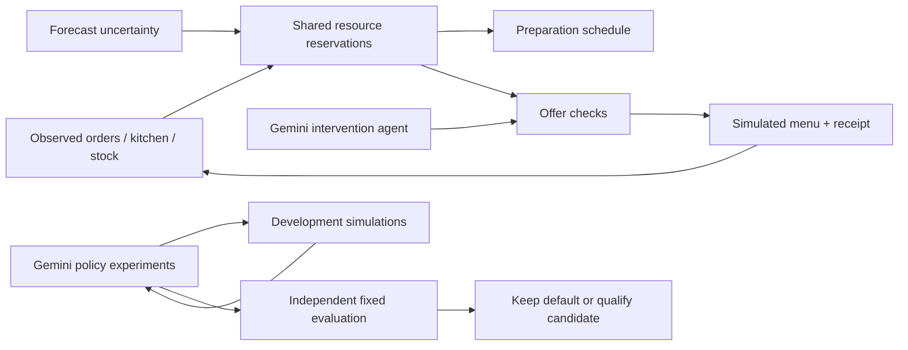

# Rush Control: working demo

Built and measured November 6, 2026, before the hackathon. Branch: `feat/rush-control`. All restaurant, customer, courier and campaign state is synthetic. Gemini calls are real. No DoorDash/Uber/POS integration or campaign spend occurred.

[Feature coverage against the full discussion](FEATURE_COVERAGE.md) distinguishes implemented, partial and unbuilt ideas. This demo is not the full earlier autonomous forecasting/staffing/stocking vision.

The source is now based on V's `origin/varun` (`300dd8d`); his clock-aware main dashboard is preserved. [Rebase and integration checks](VARUN_REBASE.md) passed with zero source conflicts, 127 Python tests and eight additional browser checks. The recording and original Gemini experiments below predate that integration; the Rush engine is unchanged.

## Open it

[Open Rush Control](http://127.0.0.1:8000/rush). The API serves the built web app; only port 8000 is needed. Restart from the repository root with `./scripts/dev.ps1 -Task api`. Build browser changes with `./scripts/dev.ps1 -Task build`.

- [Recorded browser walkthrough](../demo/rush-demo.webm)
- [Service overview](../demo/rush-overview.png)
- [Real agent pause receipt under overload](../demo/rush-agent-pause.png)
- [Real policy-lab experiment](../demo/rush-policy-lab.png)
- [Measured comparisons](../demo/evaluation.json), [sanitized live tool evidence](../demo/live-evidence.json), [browser checks](../demo/browser-checks.json)

The screenshots/video are captured app behavior, not product mockups. Walkthrough captions were added by the recording script. Saved receipts reload from the local SQLite database; the video is also usable without provider availability. Current Gemini configuration is `gemini-3.1-flash-lite`; configured availability is not a guarantee the next provider request succeeds.

## A three-minute demonstration

1. Start on **Service desk**, event-night rush, three cooks, seed 7. At 17:42 the fryer is at half speed. DoorDash, Uber Eats and pickup orders share one timeline. Accepted promises stay fixed; solid work is observed, pale work is estimated.
2. Read **What can we safely feature?** Fried food and ramen fail the modeled lead-time checks. A rice bowl uses assembly capacity. Reservations include shared cooks and packing, so a free-looking station alone is insufficient.
3. Click **Ask the agent to act**. A real Gemini tool loop inspects accepted work, compares candidates, optionally checks a different discount, and publishes or pauses the simulated offer. The receipt appears only after the action is confirmed in replay. A model failure stays an error.
4. Compare **Separate campaigns** with **Connected control**, then read the full-service results. Revenue and service can disagree. Try **Delay Dashers**: courier estimates move, original promises do not. Change cooks or choose **Beyond capacity**: the app exposes missed commitments instead of removing orders.
5. On **Strategy lab**, run an experiment or open a saved `policy lab · done` receipt. The agent tests distinct parameterized policies on three development cases. After it stops, code checks its fixed submission on six other cases against the default and a six-policy conventional search. A failed candidate leaves the default in place. Repeat model runs can choose different candidates.

**Pitch:** “Marketing and the kitchen usually make separate decisions. Gondola uses the same reservations for both: protect what we already promised, then sell what we can actually prepare. Its agent can investigate interventions and test policy changes before they earn a place in service.” This is a proposed extension to existing marketing/scheduling products, not a claim to have invented either category.

## What is implemented

| Capability | Actual implementation |
|---|---|
| Cross-channel scheduling | Seeded accepted orders, current courier estimates, two dependent tasks per order, station occupancy, shared cooking labor and separate packing; work in progress stays assigned |
| Demand steering | Approved first-party item features/discounts; guard checks stock, budget, contribution floor, lead-time reserve and existing predicted lateness against the same reservation function |
| Adaptive estimates | Completed cooking tasks update recipe effort using an exponential moving average; no use of the evaluator's unobserved duration |
| Forecast connection | Existing LightGBM synthetic-store forecast supplies an uncertainty ratio, mapped to a configurable lead-time reserve; it is not a new live weather/events feed |
| Intervention agent | Real Google ADK/Gemini tool calls choose and apply one guarded intervention, with persisted tool evidence and confirmed simulation receipt |
| Policy development | Real agent tests 2–6 distinct bounded parameter sets, reads development feedback, and submits a tested candidate; independent evaluation and conventional search determine qualification |
| Durable evidence | Local SQLite jobs/receipts survive reload; an unfinished job becomes interrupted after restart; API/provider errors never become fake AI success |

The fast service controller is deterministic; the LLM handles the intervention and experiment loop. The scheduler is a reservation heuristic, not a globally optimal solver. The policy lab searches parameters, not arbitrary new executable code or model fine-tuning.

Replay frames and agent tools share the start-of-minute decision boundary: current incidents and accepted platform orders are observed, while that minute's buyer response remains private until after the decision. This prevents the browser from showing customer knowledge the agent could not yet have.



## Fresh measurements and limits

The default UI episode uses seed 7, 27 base orders, three cooks, a minute-12 fryer slowdown, a $12 promotion budget and forecast reserve multiplier 1.15.

| Controller | Modeled contribution | Base promises met | New web orders | Average handoff wait | Food holding |
|---|---:|---:|---:|---:|---:|
| FIFO | $272.85 | 19/27 | 8 | 18.86 min | 539 min |
| Earliest promise | $272.85 | 19/27 | 8 | 17.34 min | 497 min |
| Remaining slack | $272.85 | 19/27 | 8 | 18.66 min | 509 min |
| Separate campaigns | $357.36 | 19/27 | 14 | 15.93 min | 485 min |
| Connected control | $316.88 | 19/27 | 13 | 7.58 min | 564 min |

Connected control improves average waiting in this episode while giving up contribution and increasing holding. Its worst pickup wait is **83 minutes**, versus 48 for separate campaigns. Most late work is pre-existing fryer pressure, and an unpromoted web customer can still order a congested item. A campaign controller alone cannot guarantee every incoming order is feasible. These adverse results are displayed; this demo is not a promise of universal better service or profit.

Across six fixed additional cases (different staffing, demand and incidents), the unweighted mean case wait is **6.53 vs 15.27 minutes** for connected vs separate campaigns. Mean contribution is **$298.24 vs $349.94**; both preserve 114/160 base promises. Earliest-promise scheduling meets 117/160 base promises, so our heuristic does not dominate it. All accepted orders complete in these runs. Exact per-case results remain in `evaluation.json`; this small designed benchmark is not a restaurant pilot or statistical estimate.

The first real Gemini policy experiment tested four policies and submitted **Refined Protect Rush**. Its independent service score was **76.58**, versus **86.91** for default and **89.15** for conventional search. It was **rejected**. The score is a declared synthetic proxy: contribution dollars minus $0.60 per late minute, $0.08 per holding minute and $100 per unresolved order. Penalties are assumptions, not validated business costs. An unchanged/default-equivalent submission could tie, so qualification alone does not prove meaningful innovation.

All arms use the same exogenous buyer utilities/arrival draws and task-noise rule. Offers may change buyer choices, which are modeled rather than observed conversion. Costs, channel fees, stock, cook capacity, one-item orders and one-minute task resolution are explicit simplifications. Natural orders continue when campaigns pause. Base commitments are scheduled ahead of new web bookings; earlier web bookings keep precedence over later web bookings. Future disruptions can invalidate estimates even after an offer passes checks. No dispatch feedback, travel-routing engine, multi-item recipe dependency, staff skill matrix or genuine station telemetry is implemented.

## Verification and reproduction

The invariant suite covers physical resource collisions, cook/packing dependencies, all accepted orders, budget/stock limits, rejected actions, fixed promises on ETA changes, reproducible draws, observation-only learning, distinct tested policies, independent evaluation, durable recovery, API validation and honest failure paths. The browser suite covers the complete UI flow, real Gemini publish/pause evidence, saved qualification results, overload, zero budget, provider/backend failures and responsive widths 1440/900/390.

Verified: TypeScript/Vite build; 120-test full Python regression pass, followed by 35 focused tests after the final replay/agent alignment; 11 browser checks with no JavaScript errors; and an additional post-restart saved-action reload check. Source/evidence files contain no configured provider secrets.

```powershell
# Offline tests: prevent the inherited suite from consuming a local key.
$env:GOOGLE_API_KEY=''
$env:ANTHROPIC_API_KEY=''
$env:GONDOLA_AGENTS=''
.venv/Scripts/python.exe -m pytest -q --disable-warnings
.venv/Scripts/python.exe scripts/rush_evaluate.py
```

Run the API in a separate ordinary terminal that loads the ignored `.env`. Explicit live checks (consume the configured Google key): `scripts/rush_live_smoke.py agent` or `lab`; `web/scripts/rush_e2e.py` also makes real model calls. The browser script reloads a saved real lab result; run a successful live lab first. A repeated lab can qualify or fail differently from the recorded example; the recorded browser assertion expects this captured rejected-lab fixture.

## Why this works for the hackathon

One visible disruption changes scheduling, marketing eligibility and a verified agent action. Judges can inspect the causal resource conflict and compare five methods rather than see an unsupported chat answer. The policy lab demonstrates multi-step autonomous experimentation and a real rejection gate. The browser workflow needs no hardware, live restaurant or slow partner certification. Recording and deterministic replay make the service episode reproducible if provider availability changes. Sponsor acceptance of the simulated integration still needs confirmation; advance-built code/assets must be disclosed.

## A real implementation path

1. **Observe in shadow mode.** With merchant and platform permission, receive order/ETA events through approved DoorDash/Uber/POS connectors. Normalize source IDs, item/modifier mappings, promises, cancellations and event versions. Derive preparation/packing completions from an existing KDS/POS instead of adding a new physical workflow. Without those timestamps, station progress is an estimate with visible uncertainty.
2. **Calibrate and compare.** Fit effort distributions and usable capacity from real completion traces; test staff skills, multi-item orders and packing. Replay sanitized merchant episodes against conventional dispatch/scheduling rules, keep every accepted commitment, and measure worst/percentile waits, fairness and forecast calibration. Add a real first-party capacity quote/admission check before promising a new pickup time; never rewrite already accepted promises to improve metrics.
3. **Make permitted bounded changes.** First control the merchant's own web menu/offer surface. Use versioned state, idempotency, atomic budget/inventory reservations, offer expiration, provider acknowledgments and read-back verification. Recheck after stale observations, cancellations or capacity changes; uncertain/unsupported writes stop. A production shared/multi-worker service needs authentication, a proper queue/database, replay protection and durable retries; the current loopback single-process demo is intentionally smaller.
4. **Extend to sponsor campaigns only with enabled access.** DoorDash Marketplace is approval-only ([account status definitions](https://developer.doordash.com/en-US/docs/marketplace/overview/getting_started/setting_up_account/)). [Integrated Promotions](https://developer.doordash.com/en-US/docs/marketplace/how_to/integrated_promotions/) describes incoming redemption data, not a campaign-writing API. The [Integrations Program](https://developer.doordash.com/en-US/docs/marketplace/overview/getting_started/preferred_integrations_new/) describes exclusive Campaign API access as a new-2027 Preferred benefit. Verify actual sponsor scopes, item eligibility, propagation latency and allowed update cadence before treating rapid DoorDash campaign control as feasible. Drive delivery booking is not Marketplace order/campaign access.
5. **Measure incremental value safely.** Freeze policy candidates before independent evaluation, add operational hard gates and owner limits, then perform a small merchant-approved trial. Separate customer-response effects from kitchen changes; include discounts, fees, service, cannibalization and missed demand. Let the agent propose/test policies while deterministic checks retain authority over reservations and money.

The user approved assuming the specific station-aware native loop is absent for prototyping; that remains an assumption to ask the sponsor about. See [the sponsor access assessment](../ideas/DOORDASH_FIT_AND_ACCESS.md) for prepared questions. No application or message has been sent.
